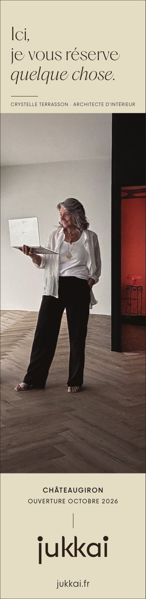

# Mlle Adèle — September 2026 « chandelle »

**Status:** sent; the first Jukkai print ad. **Owns:** what this ad was and which
file is authoritative. **Last reviewed:** 2026-10-12, reconstructed from the files
here. **Revisit when:** a printed copy or a publisher spec is found.

## Brief

- **Publication:** [Mlle Adèle](https://www.mlle-adele.fr/), free quarterly women's
  magazine for Rennes (semi-annual Côte d'Émeraude edition).
- **Issue:** September 2026 (Martin). The site lists #51, autumn 2026 Rennes, as the
  latest; not checked against a printed copy.
- **Format:** 65 × 265 mm tall column ("chandelle"), no bleed in the file. No
  publisher spec sheet is kept; the format is read from the sent PDF.
- **Job:** announce Jukkai before opening — Crystelle, interior architect, opening
  in Châteaugiron in October 2026.

## Exact copy

> Ici, / je vous réserve / _quelque chose._
> CRYSTELLE TERRASSON · ARCHITECTE D'INTÉRIEUR
> CHÂTEAUGIRON / OUVERTURE OCTOBRE 2026
> jukkai (wordmark) / jukkai.fr

## Design, as read from the PDF

- Ivory field top and bottom, photo band in the middle; the headline in PP Hatton
  Ultralight with an Ultralight Italic last line; small caps and practical text in
  PP Frama Light, Regular and Medium.
- Its ivory and house rich black were reused unchanged for the
  [business card](../../card/README.md#colour), which lists the CMYK values.
- The photograph is Crystelle standing with a laptop in the empty future gallery.

## Files

| File                                  | Role                                                                                                       | SHA-256     |
| ------------------------------------- | ---------------------------------------------------------------------------------------------------------- | ----------- |
| `jukkai-mlle-adele-2026-09.pdf`       | **Sent file.** PDF/X-1a:2003, Affinity 3.2.3, exported 2026-08-24; originally `jukkai-adele-chandelle.pdf` | `1a2c05d7…` |
| `jukkai-mlle-adele-2026-09.af`        | Editable Affinity native (was `mlle-adele-chandelle.af`)                                                   | `d054eb38…` |
| `photo-source.jpeg`                   | 5712 × 4284 photograph placed in the ad; not in `media/catalog.json`                                       | `1b5935f6…` |
| `early-study.png`                     | Superseded draft ("Crystelle Terrasson prépare", sphere logo, studioterrasson.fr). History only            | `a385e7a8…` |
| `jukkai-mlle-adele-2026-09-proof.jpg` | 150 dpi render of the sent PDF for quick viewing                                                           | —           |

The native and photo are compact enough to stay in Git; there is no Storage folder
for this campaign. Unknown: whether the publisher requested changes or confirmed print.
