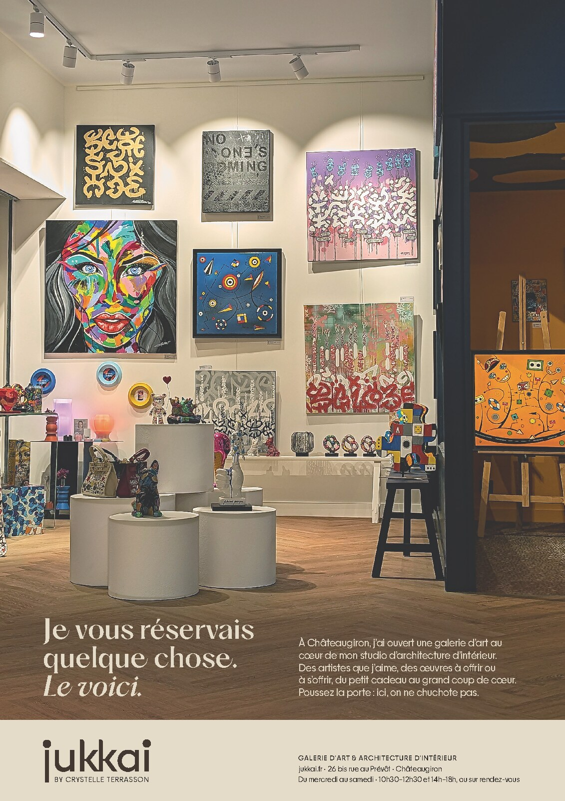

# Mlle Adèle — full page, winter issue

**Status:** v07 (v06 plus the Galerie hours) was exported and verified on 2026-11-12. Three
headline variants (v08 A–C) are built for Crystelle to choose from. Then her read of
the French, and sending.
**Owns:** the brief, the decisions, the build handoff, the values as built and where
the files live.
**Last reviewed:** 2026-11-12, after verifying Martin's v07 export.
**Revisit when:** Martin or Crystelle asks for changes, the file is exported and
sent, or a printed copy arrives.

Labels below: **Martin** means settled by him on 2026-11-12; **provisional** means an
agent recommendation he went along with; **build** means chosen by the build agent
within the brief. All public French goes to Crystelle with the proof.

## Brief

- **Publication:** [Mlle Adèle](https://www.mlle-adele.fr/), the same magazine as the
  [September chandelle](../mlle-adele-2026-09/README.md).
- **Issue:** not confirmed. The folder name assumes the winter issue, December 2026;
  rename it if that is wrong. **Material due:** as soon as it is ready (Martin).
- **Format (publisher spec, pasted by Martin):** « PAGE ENTIÈRE : Format A4 (210 mm x
  297 mm). Pas de filet ni d'hirondelles de coupe (cela pourrait se voir à
  l'impression selon calage imprimeur) + 5 mm de débord. PDF haute définition
  (300 dpi). Photos en JPEG 300 dpi. »
- **Job (Martin):** the most beautiful ad we can make. Give the Galerie momentum, and
  say, as the earlier ads did, that Jukkai is both the Galerie and interior
  architecture. A full page allows more text than before.
- **Credits (Martin):** no artist credit unless one artwork is the sole focus. The
  chosen photograph is about the Galerie, so none is needed.
- **Page side:** unknown. Text keeps at least 15 mm from both side trims so either
  binding side is safe (provisional).

## Copy

Agent draft; Martin: "the copy is nice". Crystelle validates the French.

> **Je vous réservais / quelque chose. / _Le voici._**
>
> À Châteaugiron, j'ai ouvert une galerie d'art au cœur de mon studio d'architecture
> d'intérieur. Des artistes que j'aime, des œuvres à offrir ou à s'offrir, du petit
> cadeau au grand coup de cœur. Poussez la porte : ici, on ne chuchote pas.
>
> jukkai (wordmark) · BY CRYSTELLE TERRASSON
> GALERIE D'ART & ARCHITECTURE D'INTÉRIEUR
> jukkai.fr · 26 bis rue au Prévôt · Châteaugiron
> Du mercredi au samedi · 10h30–12h30 et 14h–18h, ou sur rendez-vous

- The headline answers September's « Ici, je vous réserve quelque chose. » for the
  same readers, and still reads on its own (provisional).
- « À offrir ou à s'offrir » nods to gifts for a winter issue without dating the ad;
  « du petit cadeau au grand coup de cœur » and « on ne chuchote pas » carry the
  Tendances and October lines (provisional).
- **Hours (Martin, 2026-11-12):** the Galerie hours are printed in the band. This
  replaces November's "no hours" rule for this ad. They match the hours Martin gave
  on 2026-10-12 in [current delivery](../../../docs/operations/current-delivery.md).
  The line does not say « Galerie », so studio clients could read it as the studio's
  hours; « ou sur rendez-vous » covers them. Martin kept his exact wording.
- No prices, as in November.

## Photograph

- **Martin:** `PXL_20261111_200443664`, from `/mnt/storage/jukkai/photoshop-11-11/`,
  shot the evening of 2026-11-11. The Galerie wall lit by its track spots, white
  plinths with sculptures, herringbone floor, and the navy box with the orange-lit
  room through the doorway on the right. Work from `LONG_EXPOSURE-02.ORIGINAL.jpg`:
  Pixel Long Exposure mode keeps no RAW, so the source is a 3064 × 4080, 8-bit,
  Display P3 JPEG. It gives about 354 ppi across the 220 mm bled width.
- **No RAW (Martin, kept knowingly):**
  - Martin had RAW switched on, but the Pixel's Portrait and Long Exposure modes save
    JPEG only. In this session only the frames marked RAW have a DNG beside them.
  - No RAW frame matches this viewpoint; the closest, `192257470`, looks along the
    glass and is busier.
  - Checks on the print file: no banding in the wall or ceiling gradients, even with
    contrast exaggerated. The phone's sharpening halos are about 0.1 mm at print size.
    Colour blotches in the navy box were smoothed (see below).
  - For future shoots meant for print, use the standard Photo mode.
- **Alternate:** `PXL_20261111_200252342`, from the same spot but tighter. Martin's
  first idea; it lacks the floor that D2 needs for text without cutting the ceiling.
- **Retouch direction (provisional):**
  - Remove most of the strong yellow cast (source wall b\* about +21 to +29), so the
    lit wall reads warm white and the artworks are true.
  - Keep the orange room as the one warm pocket.
  - Straighten verticals and tone the ceiling down.
  - Lift the plinths.
  - Burn the floor gradually to about L\* 27–32 under the text.
  - Clean only technical clutter and partial fixtures cut by the top edge.
- **Provisional, carried from November:** do not repaint, remove, move or add
  artworks; colour-correct them only towards fidelity.

## Layout

Martin chose D2 from sketch comps: B1–B3, the ivory-plate family, and D1–D2, with
the headline on the photo. He preferred B3, asked whether the headline could sit on
the photo so the image takes more of the page, then chose D2.

| Element    | Direction                                                                                                                                | Status       |
| ---------- | ---------------------------------------------------------------------------------------------------------------------------------------- | ------------ |
| Trim       | 210 × 297 mm, 5 mm bleed on every side, no crop marks or frame lines                                                                     | Spec         |
| Photo      | Full bleed from the top bleed edge to 267 mm, 220 mm wide; ceiling and track lights kept; plinths centred left                           | Martin       |
| Band       | House ivory C10 M10 J20 N0, full width, 267 mm to the bottom bleed edge                                                                  | Martin       |
| Headline   | Ivory on the floor, three lines, left at the 16 mm inset, 28 pt; PP Hatton Medium with Medium Italic for « Le voici. » (Light until v05) | Provisional  |
| Body       | Ivory on the floor in a right column from 111 mm, PP Frama Regular 10 / 13 pt, last baseline shared with the headline's                  | Provisional  |
| Signature  | `jukkai-wordmark-primary-no-byline.svg` with live `BY CRYSTELLE TERRASSON`, left in the band                                             | Provisional  |
| Info block | Descriptor, address and hours in three lines, left-aligned on the body column (111 mm) in the band                                       | Martin (v07) |

- Hatton **Light**, not the September Ultralight: light type reversed out of a
  four-colour photo loses Ultralight hairlines to misregistration (provisional).
- The 9 pt reversed body over textured wood is the main legibility risk. Check it at
  300 dpi. If it fails, the fallback is D1: the body moves into an ivory band about
  45 mm tall.
- Comps were rough sketches, ImageMagick colour balance and HTML type, not design.
  They are on Storage under `comps/`. The refined comp `d2r` set the exact spec below.

## Retouch as built

Photo native v08, in Affinity 3.3.1 from the JPEG: 16-bit, with Display P3 kept until
print. Each adjustment is a live layer with an editable 16-bit mask, except the navy
noise layer.

- **Colour balance:**
  - Levels R gamma 1.08, B gamma 1.00 with input white 0.912. The B gamma was 0.917
    until v07; the cross-review asked for more warmth.
  - Curves master (0.10, 0.115), (0.50, 0.547), (0.80, 0.852).
  - On the final PDF proof, the lit wall reads b\* +13.3 (source +22; v05 +10.6), and
    the wall in falloff under the paintings +19. The white marks and the face
    painting's whites stay neutral (b\* +0.4 to +0.6).
  - A masked, colour-only correction keeps the navy at a\* −0.9, b\* −5.2; the warmer
    balance had turned it teal.
- **Orange room:** protected by the inverse balance, then +0.15 EV.
- **Navy box:** +0.35 EV.
- **Ceiling:** −0.5 EV fading to −0.3 EV, balanced just below the wall (b\* about +12). Near-clipped
  highlights (spot lenses, wall hot spots) are neutralised; the coloured lamps are
  masked out.
- **Plinths:** +0.6 EV in the middle third, falling to +0.35 EV at their silhouettes.
- **Floor:** burnt to L\* 29–31 under the text; the burn starts below the plinth
  bases.
- **Clean-up, technical only:**
  - the top-left spot head the crop would have cut;
  - 13 dust specks inside the text zones.
- **The edge-on side of a canvas hung on the navy box:** toned −1 EV and −50 %
  saturation. It read as a bright blue line down the box edge. Agent's call, not
  removed.
- **Navy box colour noise (build):**
  - The phone's JPEG and the +0.35 EV lift left low-frequency blue and purple
    blotches, visible only with contrast exaggerated.
  - A colour-only blur (100 px) inside the navy mask, lightness kept. It is a baked
    layer: regenerate it if the layers under it change.
- **Press compensation (build, on Martin's evidence):** a top Curves layer in Lab,
  lightness only.
  - Points, in → out on L\*/100: 0 → 0.087, 0.15 → 0.207, 0.42 → 0.479,
    0.70 → 0.752, 0.90 → 0.921, 1 → 1.
  - Why: see "Printing condition and ink" below.
- **Floor warmth (provisional):** a colour-only layer on the oak floor, now a\* ×1.60
  and b\* ×1.04 after the warmer balance. It puts back half the warmth that the
  corrected separation removed. Behind the text the floor reads L\* 35–37, a\* 6.5,
  b\* 21.8.
- **Unchanged:** verticals measured within 0.12°, so no rotation. No artwork was
  repainted, removed, moved or added.

**Print photo v06:**

- Crops source rows 190–3978 at full width and resamples them to 2640 × 3264 px.
  That is 12 px/mm, so it sits pixel-exact on the layout's grid.
- Sharpening: unsharp mask 0.8 px at 70 %.
- Separation: LittleCMS to **ISO Coated v2 300% (ECI)**, relative colorimetric with
  black-point compensation. Maximum ink 298 %.

The navy noise layer was regenerated after the colour-balance change.

## Layout as built (v06-MR)

v06-MR is v05 with print photo v06, the Hatton Medium headline and the 10 pt body.
The band and wordmark are unchanged since v02. Measured on Ghostscript renders of the PDF. Positions in mm from the trim's
top-left corner.

| Element    | Value                                                                                                                                                                                                                                                                                                                                  |
| ---------- | -------------------------------------------------------------------------------------------------------------------------------------------------------------------------------------------------------------------------------------------------------------------------------------------------------------------------------------- |
| Document   | CMYK FOGRA39 at 304.8 dpi (12 px/mm), so the trim (2520 × 3564 px) and the 60 px bleed are whole pixels                                                                                                                                                                                                                                |
| Photo      | −5 to 215 mm across, −5 to 267 mm down                                                                                                                                                                                                                                                                                                 |
| Band       | Ivory C10 M10 J20 N0, from 267 mm to the bottom bleed edge                                                                                                                                                                                                                                                                             |
| Headline   | PP Hatton Medium and Medium Italic, 28 / 30 pt, ivory; the J's ink at x 16.0; baselines 236.83, 247.42 and 258.00; widest line ends at 94.3                                                                                                                                                                                            |
| Body       | PP Frama Regular 10 / 13 pt, ivory, column 111.0–194.0 (ink ≤ 192.1), five lines, last baseline 258.00, 16.8 mm from the headline; no line ends on « à »                                                                                                                                                                               |
| Wordmark   | Native curves, house rich black C14 M34 J38 N90, 40.0 mm wide at x 16.0, j foot at 290.00                                                                                                                                                                                                                                              |
| Byline     | PP Frama Regular 7.031 pt, tracking +80, N100; B stem on the u's left stem, N's right edge on the i stem, baseline on the j foot                                                                                                                                                                                                       |
| Info block | Left-aligned on ink at x 111.0, the body column's edge; lines 4.04 mm apart, all N100. Descriptor: PP Frama Medium 6.8 pt capitals, tracking +80, baseline 281.92. Address: PP Frama Regular 7.4 pt, baseline 285.96, on the wordmark's baseline. Hours: PP Frama Regular 7.4 pt, baseline 290.00, on the j foot, ink ending at 193.06 |
| Clearances | Headline cap top to the front plinth 7.6 mm; text to the band 8.3 mm or more; side text 16 mm from the trim; hours descenders about 6.5 mm from the bottom                                                                                                                                                                             |
| Legibility | Floor behind the text L\* 35–37 against text at L\* 91. Thinnest reversed strokes: Hatton Medium 0.19 mm (Light was 0.16), Frama Regular 10 pt 0.27 mm                                                                                                                                                                                 |

### Changes from the handoff

- **Body bottom-aligned, not top-aligned (provisional).** The body's last line
  « Poussez la porte : ici, on ne chuchote pas. » shares its baseline with « Le
  voici. », so the two invitations end together.
- **Headline 28 pt, last baseline 258 (provisional).** At 29 pt the cap top came
  within 4 mm of the front plinth.
- **Wordmark 40 mm and byline refitted (build).**
  - The handoff's ~30 mm wordmark looked timid on a full page.
  - The byline's ~6.5 pt was an art-direction error: it forced +134 tracking. At +80,
    matching the descriptor, it fits at 7.03 pt.
- **Body column widened to 195.5 mm, with a break after « d'intérieur. » (build,
  v02).** No-break spaces after both « à » pushed « cœur. » to the last line in a
  76 mm column. In v06 the column moved to 111–194 mm and every line ends inside 194.

### Changes from the cross-review (v06)

Martin had the PR reviewed by another model with a fresh context. Its four
suggestions, and what was done with them (agent decisions; Martin exported v06-MR):

1. **Heavier body text: Frama Medium 10 / 13 pt.** It became **Regular** 10 / 13 pt.
   Medium matched the headline's weight and pulled the eye from it (variants LM and
   MM). Regular at 10 pt has 0.27 mm strokes, enough for reversed type.
2. **Warmer wall, b\* about +14 to +15.** Done, to +13.3 on the lit wall. Painting
   whites stay neutral. The wall in falloff reaches +19, which reads as light falling
   off at page size.
3. **More headline presence without more size.** Done: Hatton Medium. It is also
   more robust reversed out of the photo (0.19 mm hairlines).
4. **Scale the photo up 8–12 %, anchored bottom-left.** Declined after comps:
   - At 108 % the track lights sit half-cut on the top trim.
   - At 112 % the ceiling and lights are gone. The picture becomes a wall of art
     rather than a room to walk into, and the orange room (the studio hint) shrinks
     to a sliver.
   - The headline already has 7.6 mm of air below the plinths.

   The comp is `scale-compare` in the scratch comps, not kept.

The four variants (LR, LM, MR, MM) are natives in the session; the review sheets are
in `review/`.

### Hours line (v07)

Martin added the Galerie hours after v06. The band's information became one block
of three lines: descriptor, address, hours.

- **Left-aligned at 111 mm, the body column's edge (agent's choice; Martin chose A).**
  The page then reads as two columns: the headline and the wordmark on the left, the
  copy and the practical information on the right. The right-aligned variant B is a
  native in the session.
- **Address and hours at 7.4 pt, not 8.5.** That is the largest size at which the
  hours fit on one line inside 194 mm without tightening the tracking.

### Headline variants (v08)

On 2026-11-12 Martin wrote three other headlines to replace « Je vous réservais
quelque chose. Le voici. ». Each one is its own native, built from v07 with only
the headline changed. Martin exports them for print and Crystelle chooses.
`jukkai-mlle-adele-2026-12.pdf` stays the v07 file until she does.

| Native                  | Headline as set                                           |
| ----------------------- | --------------------------------------------------------- |
| `…-v08-A-galerie.af`    | Une galerie d’art ? / _C’était dans / mes plans._         |
| `…-v08-B-pieces.af`     | Pièces à vivre, / pièces uniques. / _Même adresse._       |
| `…-v08-C-interieurs.af` | Les intérieurs, / je les dessine. / _L’art, je l’expose._ |

- **Martin's words.** He gave the lines and the breaks marked with slashes.
- **Agent's changes, within his brief to adjust for fit:**
  - Every variant keeps v07's three lines, 28 / 30 pt, the leftmost ink at
    16.0 mm and the last baseline at 258.00, shared with the body's. The cap top
    and the clearance to the plinths are unchanged.
  - The last idea goes in Medium Italic, as « Le voici. » did.
  - A: on two lines, « C’était dans mes plans. » runs to 122 mm at 28 pt, past the
    body column at 111 mm, so it breaks after « dans ». The widest line now ends
    at 100.0 mm (v07: 94.3), which leaves 11 mm before the body.
  - A: the space before « ? » is a no-break space kerned −0.1 em to thin-space
    width. Hatton has no U+202F, and Affinity would substitute another font.
  - C: a comma was added in « L’art, je l’expose. » to mirror « Les intérieurs, je
    les dessine. ». Crystelle can drop it.
- **For Crystelle's read:** in A, the body's first sentence repeats « une galerie
  d’art » straight after the headline.

## Printing condition and ink

- **Evidence (Martin):**
  - Mlle Adèle and Tendances do not give an ICC profile.
  - September's Mlle Adèle ad printed very dark, but the printer admitted a fault, so
    it is not evidence.
  - The Tendances ads printed slightly dark: "could use a bit more light overall".
- **Hidden reconversion, found during the build:**
  - In v01–v02, the script that loaded the print TIFF into the layout silently
    reconverted its CMYK. Floor black fell about 23 %, total ink was capped near
    300 %, and the photo read about 2 L\* lighter (4 in deep shadow).
  - It is very likely why November's PDF was "about 2 L\* lighter than the placed
    TIFF". So the pipeline that printed slightly dark already had this lift.
  - From v03 the layout carries the TIFF's exact inks. Checked on the PDF's
    embedded image: a mean difference of 0.35 levels, JPEG noise only.
- **Ink limit:** with exact inks, a FOGRA39 separation reached 330 % in the navy.
  The printer and its limit are unknown, and free magazines are often web offset with
  a 300 % limit. The photo is therefore separated with ECI's ISO Coated v2 300%:
  FOGRA39 characterisation, 300 % total ink.
  - File: `ISOcoated_v2_300_eci.icc` from eci.org's `eci_offset_2009.zip`, SHA-256
    `c6b4b62f…`.
  - The layout and the PDF output intent stay Coated FOGRA39: same printing
    condition.
- **Press compensation:** sized so that the v05 PDF reads lighter than the v02 PDF,
  which used November's pipeline. Measured on PDF-rendered screen proofs, v02 → v05:

  | Area                  | Change in L\* |
  | --------------------- | ------------- |
  | Wall falloff          | +2.5          |
  | Face painting         | +3 to +3.4    |
  | Floor behind the text | +3.6          |
  | Navy                  | +3.4          |
  | Front plinth          | +3.5          |
  | Lit wall              | +0.5          |
  - Removing the reconversion also turned the navy bluer and the floor less orange.
    Half the floor warmth was put back (v05).

- **The bet:** if the press matches FOGRA39, the print comes out a touch airier than
  the proof. If it prints darker like Tendances, the compensation cancels it.

## Delivery

- **The file to send** is `jukkai-mlle-adele-2026-12.pdf`. Martin exported it by hand
  from `jukkai-mlle-adele-2026-12-v07.af`, because Affinity's scripting cannot reach
  the bleed tickbox:
  - preset PDF/X-1a:2003, Coated FOGRA39 output intent;
  - "Include bleed" ticked, every printer mark off, whole document.
- **Verified on that file:**
  - It declares PDF/X-1a:2003 with the output condition "Coated FOGRA39 (ISO
    12647-2:2004)".
  - Page boxes: MediaBox 623.622 × 870.236 pt (A4 plus 5 mm bleed), TrimBox inset
    14.17 pt; no ArtBox or BleedBox entries.
  - All four fonts are embedded as subsets: Hatton Medium and Medium Italic, Frama
    Regular and Medium.
  - No RGB, no ICC-based colour, no spot colours.
- **Verified against the v06 print photo** (both v06-MR and v07 carry it):
  - The embedded photo is a 2640 × 3265 CMYK JPEG. Its channel means equal
    `print-photo-443-220x272-iso300-v06.tif` (C 33.5, M 40.1, Y 52.6, K 35.7) within
    0.02, once the CMYK JPEG's inverted storage is allowed for.
  - Maximum total ink 300.0 %; 0.16 % of the trim is above 290 %.
  - The bleed is printed on all four sides. The only unprinted pixels are 425 photo
    highlights on the left edge, which continue inside the trim.
- **Verified against v06:** the embedded photo is pixel-identical to the v06-MR export
  verified above. Rendered at 304.8 dpi, the pages differ only inside the information
  block (x 111–194 mm, y 280–291 mm). The band text extracts exactly as written, with
  en dashes and middle dots.
- **Earlier exports, verified the same way and replaced, both in Git history:**
  - v05 (`f12133a6…`), replaced after the cross-review;
  - v06-MR (`0f0266b5…`), replaced when the hours were added.
- The review PDFs v01–v05 had bleed boxes added after export by the build agent, and
  still carry an ArtBox the size of the media box. Proofing only; never send them.
- **Rendering artefact:** Ghostscript at exactly 300 dpi draws 1 px white lines across
  the photo. They are not in the file; render at 120, 304.8 or 600 dpi. In Martin's
  shell `gs` is a git alias, so use `/usr/bin/gs`.

## Files

In this folder:

| File                                  | Role                                                                            | SHA-256     |
| ------------------------------------- | ------------------------------------------------------------------------------- | ----------- |
| `jukkai-mlle-adele-2026-12.pdf`       | **File to send.** PDF/X-1a:2003, exported by Martin from layout v07, 2026-11-12 | `ec6887ff…` |
| `jukkai-mlle-adele-2026-12-proof.jpg` | 1131 × 1600 px render of the file to send through FOGRA39                       | `7faf9486…` |

The Affinity session is `~/Desktop/jukkai-mlle-adele-full-page/` until the file is
sent. It holds:

- layout natives v01–v05, the v06 variants LR, LM, MR and MM, v07 with v07-B, and the
  headline variants v08-A, v08-B and v08-C;
- photo natives v01 (the alternate) and 443-v01–v08;
- print photos v01–v03 (FOGRA39) and v04–v06 (ISO Coated v2 300%);
- review PDFs, `review/` renders, `profiles/`, and `build/` masks, scripts and
  parameters. It is mirrored to Storage with SHA-256 sums once the
  file is sent.

On Storage under `/mnt/storage/jukkai/campaigns/mlle-adele-2026-12/`:

| Path     | Role                                                                          |
| -------- | ----------------------------------------------------------------------------- |
| `comps/` | Direction comps B1–B3, D1 (both photos), D2 and the refined D2r, with sources |

## Open

- Crystelle's choice among v07 and the v08 headlines, her read of the French and
  her greenlight. The body French has not changed since v02.
- Send the file to Mlle Adèle and record the date here. Full SHA-256 of the file to
  send: `ec6887ffc3209759093cec1cc40f86bac5f3a7ff20c662292a000db5ea97a749`.
- Mirror the session to Storage and empty the Desktop folder.
- The issue month and page side, if Mlle Adèle can say. Martin asked for the
  profile; they do not give one.
- When the printed issue arrives, compare it with the proof under daylight and
  record whether the press compensation was right, too little or too much.
