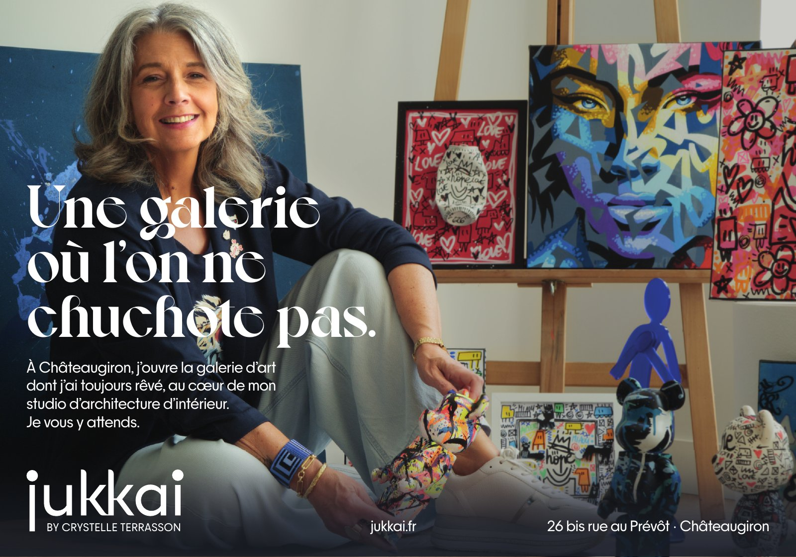

# Tendances — October 2026 half page

**Status:** sent 2026-09-14 for the October issue. **Owns:** what this ad was, its
accepted values and where its files live. **Last reviewed:** 2026-10-12, from the
sent PDF and the September delivery records. **Revisit when:** a printed copy
arrives or this layout is reused.

## Brief

- **Publication:** [Tendances Magazine](https://www.tendances-magazine.com/nos-editions-papier/).
- **Format:** « demi page » 180 × 126 mm, no bleed, CMYK; see the
  [2024 media kit](../tendances-2026-quarter-page/tendances-media-kit-2024.pdf).
- **Job:** announce the Galerie opening — Crystelle among the artworks, in her own voice.

## Exact copy

> **Une galerie / où l'on ne / chuchote pas.**
> À Châteaugiron, j'ouvre la galerie d'art dont j'ai toujours rêvé, au cœur de mon
> studio d'architecture d'intérieur. Je vous y attends.
> jukkai (wordmark) BY CRYSTELLE TERRASSON · jukkai.fr · 26 bis rue au Prévôt · Châteaugiron

## Accepted values

From the v10 delivery note, accepted on 2026-09-14. The body
position and the ~3 mm headline/body gap were deliberately kept.

| Element        | Value                                                                                                                            |
| -------------- | -------------------------------------------------------------------------------------------------------------------------------- |
| Headline       | Voyage Bold 38.64 pt / 35.2 pt leading, tracking −1; x 6 mm, y 42 mm; three lines                                                |
| Body           | PP Frama Regular 9 / 11.75 pt; x 6 mm, y 81.9 mm; 61.4 mm frame; four lines                                                      |
| Wordmark       | Native SVG curves, 35.5 mm wide; x 6 mm, y 106.3 mm                                                                              |
| Byline         | Live PP Frama Regular 6.5 pt, tracking +35, `BY CRYSTELLE TERRASSON`; x 9.75 mm                                                  |
| Practical text | PP Frama Regular 8.75 pt; URL centred at x 89 mm; address right-aligned to 174 mm                                                |
| Margins        | Shared 6 mm left inset; 6 mm right inset; footer baseline ~120.3 mm, 5.7 mm above trim                                           |
| Footer fade    | Navy opacity gradient, full width, y 102–126 mm: 0 % @102, 10 % @107, 40 % @113, 70 % @119, 86 % @126                            |
| Navy           | C85.49 M73.33 Y52.55 K67.06, derived from Crystelle's jacket                                                                     |
| Photograph     | [`crystelle-galerie`](../../../media/catalog.json) 7600 × 5700, placed 180 × 135 mm at x 0, y −8 mm; no retouching or local wash |

The photo is identified by its dimensions and content; the native was not reopened
to confirm it. The delivery note left one physical-proof check open: fine reversed
strokes over the pale knee.

## Files

In this folder:

| File                                 | Role                                                                                                 | SHA-256     |
| ------------------------------------ | ---------------------------------------------------------------------------------------------------- | ----------- |
| `jukkai-tendances-2026-10.pdf`       | **Sent file.** PDF/X-1a:2003, exported 2026-09-14 06:04; originally `Jukkai-Tendances-180x126mm.pdf` | `69efe9bc…` |
| `jukkai-tendances-2026-10-proof.jpg` | 1600 px render of the sent PDF                                                                       | —           |
| `jukkai-postcard-a6-proof.jpg`       | Preview of the derived postcard print file                                                           | —           |

On Storage, under `/mnt/storage/jukkai/`:

| Path                                                                   | Role                                                                              |
| ---------------------------------------------------------------------- | --------------------------------------------------------------------------------- |
| `campaigns/tendances-2026-10/jukkai-tendances-v10-refinement.affinity` | Editable native, 208 MB, resources embedded; SHA-256 `a6c2896c…`                  |
| `campaigns/tendances-2026-10/jukkai-postcard-*`                        | Postcard natives v01–v03, review PDFs, VistaPrint TIFF and print notes            |
| `records/2026-09-production/tendances-final/`                          | v10 delivery note, manifest and delivery check (confirms the sent PDF's hash)     |
| `media/scenes/ouverture/exports/ouverture-print.tif`                   | Separate photo sent the same week for the magazine's openings section, not the ad |

The native was saved again at 05:59, after the delivery manifest recorded it
(`72339c87…`); the sent PDF was exported from that save. Treat the sent PDF as the
record of what ran. The v10 preview and review PDF were pruned in the September
consolidation; the proof here replaces them.

## Derived postcard

A VistaPrint A6 landscape postcard reuses the layout: 148 × 105 mm trim, 1.5 mm
bleed, 300 ppi CMYK TIFF with FOGRA39 embedded. Its print notes say it has not been
uploaded or physically proofed. A copy is in the 22 September image package prepared for Crystelle.
