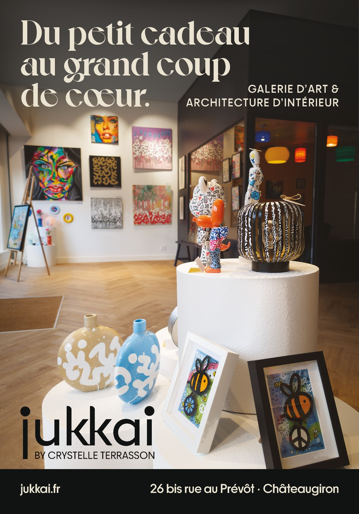

# Tendances — November 2026 quarter page

**Status:** built 2026-10-12; the PDF is ready to send once Crystelle greenlights
the proof. **Material due 2026-10-13.**
**Owns:** the brief, the build handoff, what was built, its accepted values and
where its files live.
**Last reviewed:** 2026-10-12, after the byline alignment and the Regular band text.
**Revisit when:** Crystelle greenlights or asks for changes, the file is sent, or a
printed copy arrives.

Labels below: **Martin** means settled by him on 2026-10-12, in the grilling
session or during the build; **provisional** means an agent recommendation he went
along with; **build** means chosen by the build agent from measurements on the
photo, within the brief. All public French goes to Crystelle with the proof.

## Brief

- **Publication:** Tendances Magazine, November 2026 issue, « 1/4 de page »
  (Martin). Material due 2026-10-13.
- **Context (Martin):** a large holiday shopping section, about half the magazine.
  The 2025 editions show local ads (apparel, saunas and the like) that are well
  made, so the bar is polished, not loud.
- **Approval (Martin):** Martin builds the finished ad; Crystelle greenlights it,
  at most with small tweaks. She trusts him and knows time is short.
- **Job (Martin):** build the Jukkai name and make people want to come. Beauty
  wins over commercial detail in any trade-off.
- **Message:** a new Galerie in Châteaugiron where art spans every budget, from a
  small gift to a major piece; come in, no pressure to buy. Interior architecture
  is present but quiet: the photo shows the studio behind the glass and one line
  names it.
- **Continuity:** October's half page announced the opening; this one shows the
  open Galerie.

## Copy

As set in the file:

> **Du petit cadeau / au grand coup / de cœur.** _(Martin)_
> GALERIE D’ART & / ARCHITECTURE D’INTÉRIEUR _(provisional wording)_
> jukkai (wordmark) · BY CRYSTELLE TERRASSON
> jukkai.fr · 26 bis rue au Prévôt · Châteaugiron

- The headline pairs with the photo: small pieces in front, large works behind.
  It uses the foundation's « coup de cœur » territory without sales vocabulary.
- **Martin:** no hours (readers find them on jukkai.fr), no prices, no event
  promise. Crystelle's name must stay visible and readable.
- Crystelle sees the French in the finished proof and greenlights it
  (foundation §11).

## Photograph

- **Martin:** `PXL_20261009_160750985`, from
  `/mnt/storage/jukkai/photos-galerie-open/`; work from the
  `.RAW-02.ORIGINAL.dng` (6124 × 8156, Pixel). Vases and two framed bees on white
  plinths in front, sculptures mid-ground, the gallery wall and the colourful
  meeting room behind glass at the back.
- Several pieces share the frame, so no artist credit is needed (Martin's rule:
  one dominant artwork requires the artist's name). Keep the crop wide enough that
  the foreground Mister Zion bee frame does not become the subject.
- **Martin:** heavy retouching is welcome. The goal is a shot that holds its own
  next to a high-budget ad: grading, white balance, tone mapping, relighting,
  depth-of-field blur, masking, local dodge and burn, cleanup of track spots and
  rails, perspective correction, extending plain surfaces (ceiling, wall, plinth).
- **Provisional:** do not repaint, remove, move or add artworks; colour-correct
  them only towards fidelity. Artists' works stay recognisable and the photo stays
  an honest picture of the Galerie.

As retouched (build), in the photo native on Storage:

- Developed in Affinity 3.3.1 from the DNG and kept as an embedded live RAW layer:
  white balance 0.60, exposure +0.35, highlights −0.25, shadows +0.10, clarity
  +0.08; Adobe RGB, 16-bit.
- Ceiling: track rails and spots removed, and the plain ceiling extended 400 px
  (4.5 mm in the ad) above the frame from a surface fitted to the ceiling's own
  tone, with matched grain. The dark meeting-room box ends at its top corner,
  found by extending its two measured edges. This one pixel layer was computed
  outside Affinity from an export of the RAW layer, then loaded as a layer.
- Live masked adjustments: ceiling relit −0.7 EV; back wall white balance −0.22,
  which removes the spotlights' yellow cast from the wall and its paintings
  (towards fidelity); plinth faces +0.45 EV with the artworks masked out; floor
  edges −0.35 EV; left window reveal −0.6 EV; a gentle global S curve; ceiling
  saturation −80 %, added with the neutral black (photo v05) so the ceiling under
  the gradient reads charcoal rather than brown; the tall pedestal's face burnt up
  to −0.4 EV at its silhouette, rising as u² from 0 at its centre, with both frames,
  the sculptures, its top and the lower plinths masked out (photo v06), so it reads
  as a cylinder.
- No artwork repainted, removed, moved or added. No depth-of-field blur was added:
  the phone's own falloff is enough at print size.

## Layout handoff

Rough direction comps (ImageMagick, not design) are on Storage under
`/mnt/storage/jukkai/campaigns/tendances-2026-11/comps/`; `comp-03` and
`comp-04` show the chosen direction, `comp-01` and `comp-02` the options it beat.

| Element    | Direction                                                                                                                                                                              | Status      |
| ---------- | -------------------------------------------------------------------------------------------------------------------------------------------------------------------------------------- | ----------- |
| Trim       | 88 × 126 mm, no bleed; keep text ≥ 4.5 mm from every edge                                                                                                                              | Media kit   |
| Photo      | Fills 88 × 115 mm above the band; source crop anchored at the bottom so the white plinth carries the signature                                                                         | Martin      |
| Band       | ~11 mm full-width dark band at the bottom; colour sampled from the dark wall in the graded photo or house rich black; not K100 alone                                                   | Martin      |
| Headline   | Voyage Bold, ivory, ~23–26 pt, top-left, three lines; no line over the face painting (adjust breaks or crop)                                                                           | Martin      |
| Overlay    | Top gradient, only as dark as the headline needs; the gallery wall should stay light below it                                                                                          | Martin      |
| Descriptor | PP Frama Medium 7 pt capitals, tracked, ivory, under the headline                                                                                                                      | Provisional |
| Signature  | `jukkai-wordmark-primary-no-byline.svg`, ~35 mm wide, rich black on the plinth, bottom-left; live `BY CRYSTELLE TERRASSON` PP Frama 6.5 pt, tracked, as in October; clear of the vases | Martin      |
| Band text  | PP Frama Medium 8 pt, ivory: `jukkai.fr` left at the inset, address right-aligned to the inset                                                                                         | Martin      |

- The built-in byline of `jukkai-wordmark-primary.svg` prints at about 3.5 pt at
  this size: do not use it.
- Colours: ivory C10 M10 J20 N0; house rich black C14 M34 J38 N90. Small reversed
  type on the band needs a black built mostly on K to avoid misregistration fringes.

## Accepted values

Built 2026-10-12 and measured from renders of the native and of the PDF.
Crystelle's greenlight is pending.

| Element      | Value                                                                                                                                                                                       |
| ------------ | ------------------------------------------------------------------------------------------------------------------------------------------------------------------------------------------- |
| Trim         | 88 × 126 mm, no bleed; MediaBox = TrimBox 249.449 × 357.165 pt. The layout is set at 304.8 dpi so both sides are whole pixels; at 300 dpi Affinity rounded the page up to 88.05 × 126.07 mm |
| Insets       | 5.0 mm left, right and top; the descriptor and the address share the 83.0 mm right edge                                                                                                     |
| Photo        | 88 × 115 mm at the top, full source width (6124 px); content shifted down 4.50 mm into the extended ceiling, which crops the bottom of the plinths                                          |
| Top gradient | Neutral rich black, full width, 0–32 mm: 48 % at 0, 48 % at 8, 44 % at 16, 42 % at 22, 24 % at 26, 8 % at 29 and 0 at 32 mm                                                                 |
| Band         | Neutral rich black C30 M20 J20 N100 (170 % ink), full width, 115–126 mm; FOGRA39 predicts L\* 13, a\* 0, b\* −1                                                                             |
| Headline     | Voyage Bold 24 / 21.5 pt, ivory, x 5.0 mm; cap top 5.0 mm; baselines 10.93, 18.51 and 26.10 mm                                                                                              |
| Descriptor   | PP Frama Medium 7 / 9.5 pt capitals, tracking +80, ivory, two lines right-aligned to 83.0 mm; baselines 22.76 and 26.10 mm, the second on the headline's last line                          |
| Wordmark     | `jukkai-wordmark-primary-no-byline.svg` as native curves (non-zero fill), neutral rich black, 32.8 mm wide; x 5.0, top 99.56, j foot 112.50 mm                                              |
| Byline       | Live PP Frama Regular 6.356 pt, tracking +19, N100; the B's stem on the u's left stem (8.655 mm), the N's right edge on the i stem's (37.19 mm); baseline 112.50 mm on the j foot           |
| Band text    | PP Frama Regular 8 pt, ivory; `jukkai.fr` at x 5.0, address right-aligned to 83.0 mm; baseline 120.85 mm, descenders 4.5 mm above the trim                                                  |
| Clearances   | Headline to the small face painting 2.1 mm; descriptor to the glass 2 mm; k and i stems to the vases ≥ 1.8 mm; i to the white bee frame 1.5 mm                                              |

### Changes from the handoff

- **Descriptor beside the headline's last line, on the dark wall (Martin, during
  the build).** Measured on the DNG: at full width the wordmark's i falls in a
  2.5 mm gap between the blue vase and the white bee frame, so the signature cannot
  drop lower, and a descriptor under the headline would sit on the paintings.
  Keeping it there meant shrinking the photo to about 95.5 % and retouching in
  strips of floor, window, glass and part of a lamp. The comps were zoomed in,
  which hid this. The option mock is in `review/` on Storage.
- **Wordmark 32.8 mm, not ~35 (build):** the widest that keeps the i clear of the
  white bee frame.
- **Byline +19, not +35 (build):** at this wordmark size, +35 overhangs the i by
  0.8 mm.
- **Neutral rich black C30 M20 J20 N100 for the band, top gradient and wordmark,
  not house rich black (Martin, after the first proof).** House rich black is
  warm by recipe (M34 J38 under N90); across a full-width band it read as brown,
  and FOGRA39 predicts it prints that way (L\* 21, a\* +3, b\* +4). The neutral
  black prints L\* 13, a\* 0, b\* −1 and is mostly K, so the reversed ivory stays
  clean. Martin chose it, with the ceiling desaturated, from three renders in
  `review/colour-options-A-B-C.jpg`: current, neutral black, and neutral black with a
  neutral ceiling. The house rich black itself is unchanged.
- **Byline in N100 (build, within Martin's neutral-black direction):** he asked for
  one neutral black across the wordmark and byline. A 6.4 pt regular weight in four
  inks would fringe at any misregistration, so the byline stays on the black plate,
  as on the business card. N100 is neutral too (L\* 16).
- **Top gradient lightened to match A (Martin, variant G1).** Neutral black is
  darker than house black, so with the same stops the top came out 2–6 L\* darker
  than A. Martin asked to lower only the 0, 8 and 16 mm stops until three readings
  (median L\*, glyphs excluded) match A within ±1. Exact matches would have needed a
  gradient that darkens again lower down, so the build agent kept it monotonic. G1
  reads 22.4, 31.2 and 35.9 against A's 23.2, 30.5 and 36.6; everything below
  22.4 mm is identical to the neutral-black version. G2, halfway, was the other
  option; both are in `review/variants-2026-10-12/` on Storage.
- **Pedestal edge burn (Martin, on the build agent's recommendation).** Martin
  asked for it so the pedestal would stop being the biggest bright shape in a
  blurred greyscale thumbnail. It does not achieve that: the bright area barely
  shrinks (735 → 717 mm² above L\* 80), and modelling showed that a burn strong
  enough to change the ranking makes the white bee frame the biggest bright shape
  instead. It was kept because the face reads rounder at full size.
- **Byline aligned on the i stem (Martin).** At 6.5 pt the N ended flush with the
  round i dot, which sticks out past the stem, so the N overhung the stem by
  0.66 mm. Martin asked for a neat alignment. The byline is now 6.356 pt with the same
  +19 tracking, so its B starts on the u's left stem and its N ends on the i stem's
  right edge, both within 0.002 mm in a 2400 dpi render. Keeping 6.5 pt would have
  needed tracking +4.5, which crowded the capitals; the comparison is in
  `review/type-2026-10-12/` on Storage.
- **Band text in Frama Regular, not Medium (Martin, on the build agent's
  recommendation).** In Medium, the URL and address were the heaviest small type
  on the page and competed with the wordmark and descriptor. Regular strokes
  measure 0.30 mm against 0.36 mm, still comfortable for 8 pt reversed out of the
  band; positions and baseline are unchanged.

## Delivery

- PDF/X-1a:2003 from Affinity 3.3.1 with the same preset as October: CMYK with the
  Coated FOGRA39 output intent; Voyage Bold, PP Frama Medium and PP Frama Regular
  embedded as subsets; no RGB. Transparency is flattened, so the photo and the
  gradient area are 300 ppi CMYK images while all text stays vector. Highest ink
  coverage 296 %.
- On export Affinity re-separates the placed CMYK photo with less black (floor K
  21 % → 12 %), so the PDF prints about 2 L\* lighter than the placed TIFF in the
  midtones. Barely visible; not corrected.
- The proof is a render of the PDF itself (Ghostscript CMYK, converted through
  FOGRA39 to sRGB). It matches Affinity's own render within 2 levels.
- Proof checks done by the build agent at 300 dpi: byline and band text legible;
  headline clean over the gradient; no text over artwork; no single artwork
  dominating. Not done: a physical proof, and Crystelle's read of the French.

## Files

In this folder:

| File                                 | Role                                                                              | SHA-256     |
| ------------------------------------ | --------------------------------------------------------------------------------- | ----------- |
| `jukkai-tendances-2026-11.pdf`       | **File to send.** PDF/X-1a:2003, exported 2026-10-12 20:51 from layout native v07 | `8aeb6f16…` |
| `jukkai-tendances-2026-11-proof.jpg` | 1117 × 1600 px render of that PDF                                                 | `a3f0da92…` |
| `tendances-media-kit-2024.pdf`       | The publisher's spec sheet                                                        | `d26b8d9d…` |

Full SHA-256 of the file to send:
`8aeb6f164c3a9e32ce51225790b2d68e3428266be278774c2a57f54132aa70ff`. Three earlier
exports are in Git history and were never sent: `28277674…` (house rich black, and
print photo v01 without the window-reveal burn, because the scripted photo swap had
silently done nothing), `c9774624…` (neutral black with the original gradient, no
pedestal burn) and `2ec1759b…` (G1 and the pedestal burn, with the 6.5 pt byline
and Medium band text).

On Storage, under `/mnt/storage/jukkai/campaigns/tendances-2026-11/`, with every
file's SHA-256 in `SHA256SUMS` there:

| Path                                                                                      | Role                                                                                                                                                                                                                                                          |
| ----------------------------------------------------------------------------------------- | ------------------------------------------------------------------------------------------------------------------------------------------------------------------------------------------------------------------------------------------------------------- |
| `jukkai-tendances-2026-11-v07.af`                                                         | **Layout native**, CMYK FOGRA39 at 304.8 dpi, photo embedded; exported the PDF. `81d807c0…`                                                                                                                                                                   |
| `jukkai-tendances-2026-11-photo-v06.af`                                                   | **Photo native**, 426 MB: embedded RAW layer, ceiling layer and the masked adjustments. `59451932…`                                                                                                                                                           |
| `jukkai-tendances-2026-11-print-photo-v04.af`, `print-photo-88x115-300ppi-fogra39-v4.tif` | The 88 × 115 mm crop at 300 ppi, sharpened and converted to FOGRA39: the image placed in the layout. `b848f76b…`, `2c79b54f…`                                                                                                                                 |
| `photo-master-crop-88x115-full.jpg`                                                       | The same crop from photo v04 (before the ceiling desaturation and pedestal burn), flattened at 6124 × 8003, Adobe RGB, for reuse. `5a905109…`                                                                                                                 |
| `build/`                                                                                  | Ceiling layer PNG, adjustment masks (including the pedestal's), the scripts that made them and the gradient solve, and the wordmark path data                                                                                                                 |
| `review/`                                                                                 | The descriptor A/B mock, the colour A/B/C renders, review renders, `variants-2026-10-12/` (G1, G2 and P PDFs, crops, squint thumbnails) and `type-2026-10-12/` (byline and band text comparisons)                                                             |
| `comps/`                                                                                  | Direction comps from the brief                                                                                                                                                                                                                                |
| Other `*.af` and `print-photo-*.tif`                                                      | Iterations: layout v01–v03 (house rich black, print photo v01; v01–v02 at a 300 dpi page), v04 (neutral black), v05-g1/g2/p (variants), v06 (G1 and the pedestal burn, 6.5 pt byline, Medium band text); photo v01 (develop only) to v05; print photo v01–v03 |

The print crop takes rows 87 to 8090 of the extended photo canvas (6124 × 8556).

## From the media kit

Source: [`tendances-media-kit-2024.pdf`](tendances-media-kit-2024.pdf), the
publisher's "Contraintes techniques — formats 2024" sheet (InDesign export dated
2023-11-28). It is the 2024 edition; Martin confirms it applies, as it is the
sheet Tendances sent Crystelle for this booking.

- **1/4 page: 88 × 126 mm, no bleed.** Same height as the October half page
  (180 × 126), less than half its width.
- **Reserved for « shopping » themes**, published in the November and December
  issues (end-of-year holidays), May (Mother's Day) or summer (summer shopping).
- **Files:** JPG at 300 dpi or high-definition PDF, CMYK. Accepted: JPG, TIFF, PDF,
  AI, PSD, InDesign; no Word, PowerPoint or Publisher.
- Other formats, for comparison: double page 420 × 297 and full page 210 × 297 (both
  +5 mm bleed, 5 mm safety margin), half page 180 × 126 without bleed. The
  « confidentiel / tiers de page » insertion follows a separate publisher charter.

## Open

- Crystelle's greenlight on the proof, including the French, the descriptor
  beside the headline and the neutral black.
- Send the PDF to Tendances by 2026-10-13; record the date and any publisher
  feedback here.
- On the printed copy, check that the band and top read neutral, and the
  reversed 8 pt ivory on the band.
- The Desktop session `~/Desktop/jukkai-tendances-2026-11/` stays until the
  greenlight, for small tweaks; empty it afterwards per the media workflow.
